# Organization Hub

Organization Hub는 문서·일정·할 일·결재를 하나의 웹에서 운영하는 조직용 업무 허브입니다.  
팀과 직책이 있는 조직이 자료를 나누어 관리하고, 일정과 할 일을 함께 보고, 결재 흐름까지 같은 공간에서 처리할 수 있도록 돕습니다.

Google Workspace를 이미 사용하고 있다면 Organization Hub는 흩어진 업무 흐름을 하나로 묶어 줍니다.  
사용자는 여러 Google 화면을 오가지 않고, 자신에게 필요한 업무를 Organization Hub 안에서 확인하고 처리합니다.

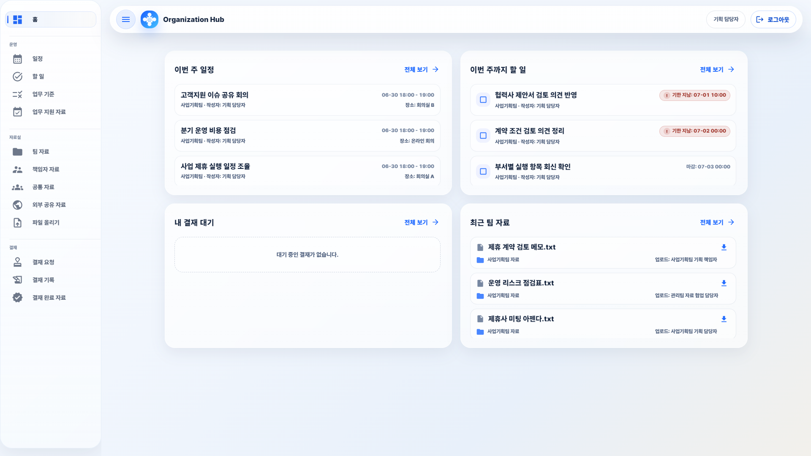

## 이런 조직에 잘 맞습니다

- 팀별 자료와 공통 자료를 구분해서 관리해야 하는 조직
- 직책에 따라 볼 수 있는 자료와 처리할 수 있는 일이 다른 조직
- 일정·할 일·결재 요청이 여러 도구에 흩어져 있는 조직
- 관리자가 조직 구조와 권한을 직접 조정해야 하는 조직
- Google Workspace는 사용하지만 팀 운영 흐름은 더 정돈하고 싶은 조직

## Organization Hub가 주는 가치

### 업무가 한 화면에 모입니다

홈 화면에서는 이번 주 일정, 이번 주까지 할 일, 내 결재 대기, 최근 팀 자료를 한곳에서 볼 수 있습니다.  
사용자는 오늘 무엇을 확인해야 하는지 빠르게 파악하고 필요한 화면으로 바로 이동합니다.

### 팀과 직책에 맞게 보입니다

Organization Hub는 팀 이름과 직책 이름을 조직에 맞게 설정합니다.  
같은 직책명이 여러 팀에서 쓰일 수도 있고, 팀마다 완전히 다른 직책 체계를 둘 수도 있습니다.

관리자는 직책별로 자료·일정·할 일·결재·관리 기능의 사용 범위를 정합니다.  
사용자는 자신의 역할에 맞는 메뉴와 업무만 보게 되므로 복잡한 설정을 알 필요 없이 자연스럽게 사용할 수 있습니다.

### 자료와 결재가 이어집니다

자료실에서 문서를 찾고, 필요한 파일을 첨부해 결재를 요청하고, 완료된 승인본을 다시 정리할 수 있습니다.  
문서 관리와 결재 과정이 분리되지 않아 팀 운영의 흐름이 더 선명해집니다.

### 조직 운영자가 직접 조정할 수 있습니다

조직 구조가 바뀌어도 코드를 수정할 필요가 없습니다.  
팀·직책·사용자·권한·결재 경로·메뉴 구성을 관리 화면에서 직접 바꿀 수 있어, 조직 변화에 맞춰 운영 방식을 빠르게 정리할 수 있습니다.

## 주요 화면

### 자료실

팀 자료, 관리팀 자료, 공통 자료, 책임자 자료, 외부 공유 자료처럼 실제 조직의 자료 구분에 맞춰 사용할 수 있습니다.  
자료를 올리고 찾고 정리하는 흐름이 한 화면 안에서 이어집니다.

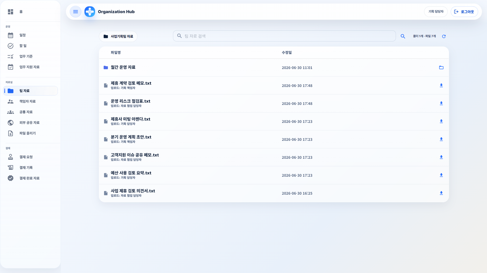

### 일정과 할 일

조직 공용 일정, 팀별 일정, 책임자 일정처럼 업무 단위에 맞게 일정을 나눌 수 있습니다.  
할 일은 마감 기한과 완료 상태를 함께 관리해 이번 주에 처리해야 할 일을 놓치지 않게 합니다.

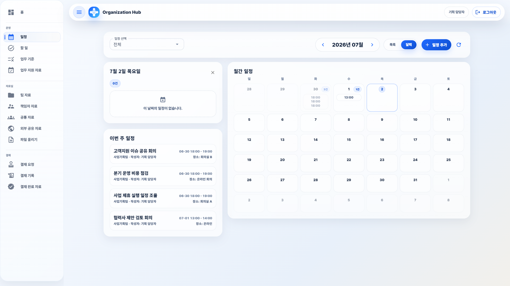

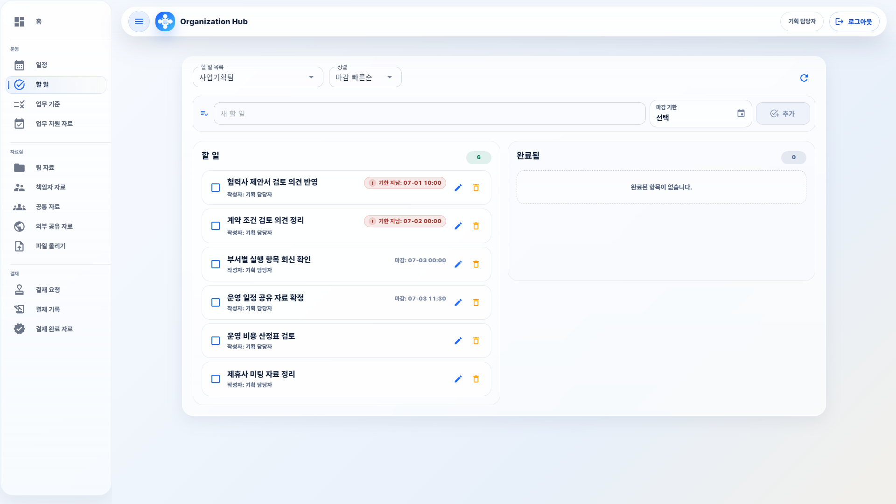

### 결재

관리자가 정한 결재 경로에 따라 요청자, 검토자, 결재권자의 흐름이 정리됩니다.  
1단계 결재부터 여러 검토자를 거치는 결재까지 조직 방식에 맞게 구성할 수 있습니다.

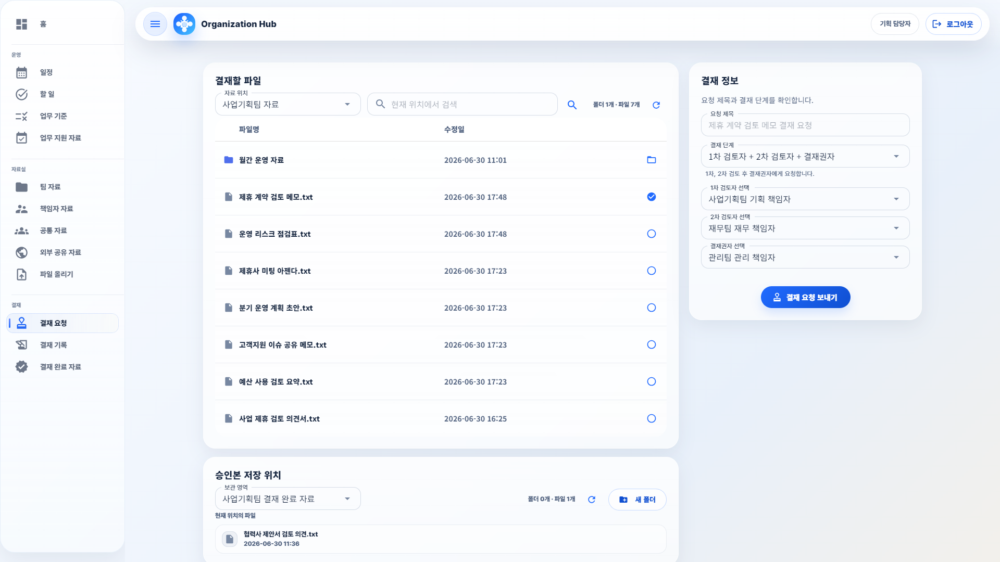

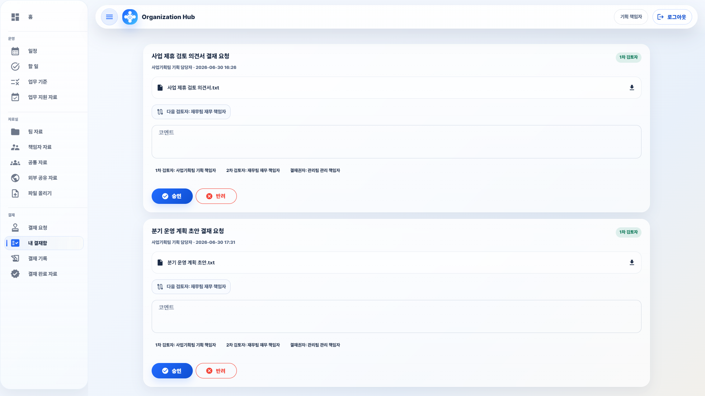

### 관리자 설정

관리자는 팀과 직책을 만들고, 사용자에게 역할을 배정하고, 메뉴와 권한을 조정합니다.  
결재 경로와 업무 기준도 같은 관리 화면에서 운영할 수 있습니다.

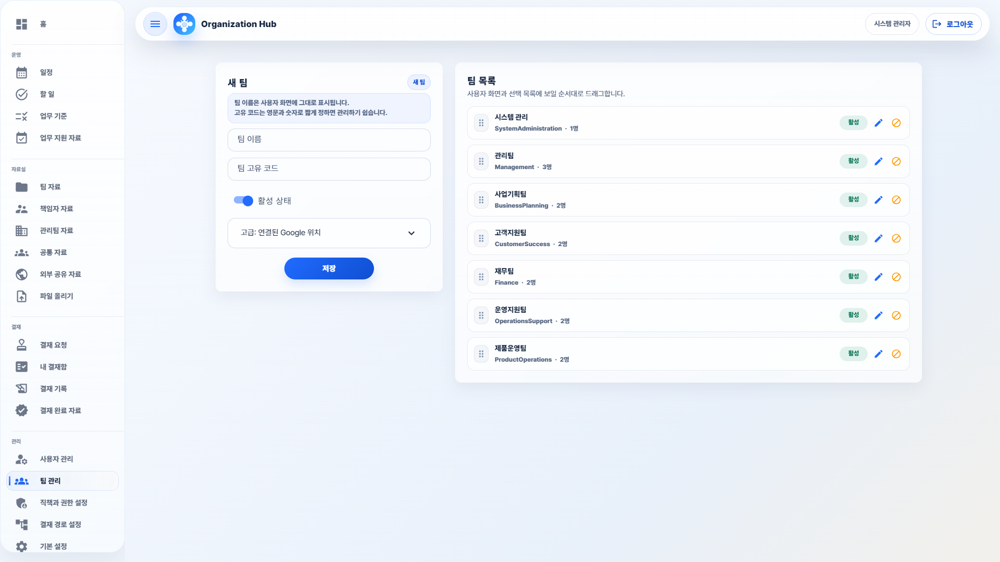

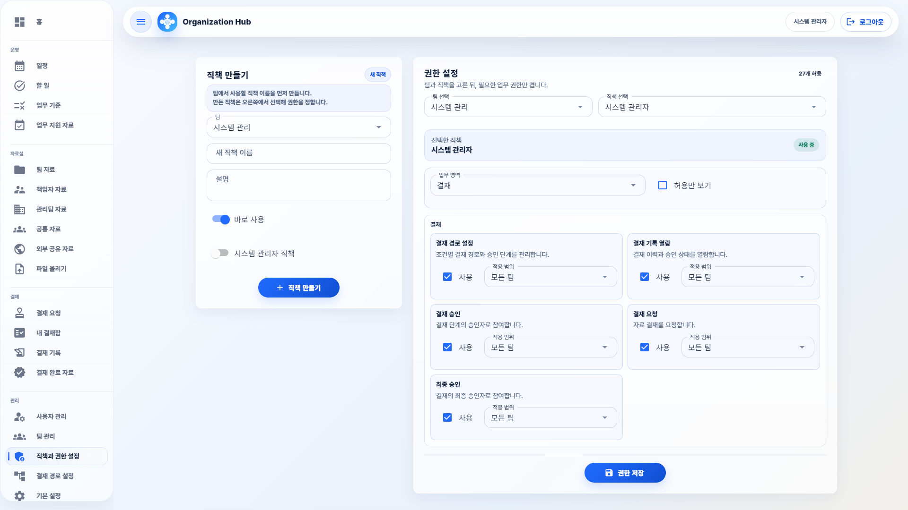

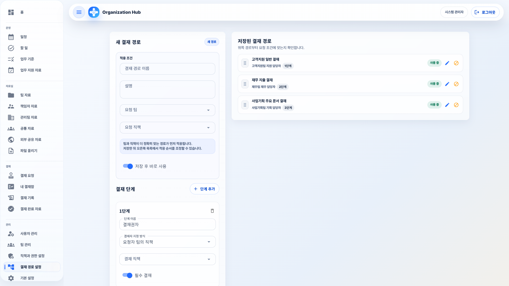

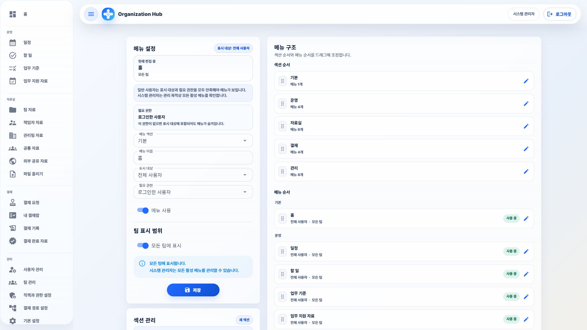

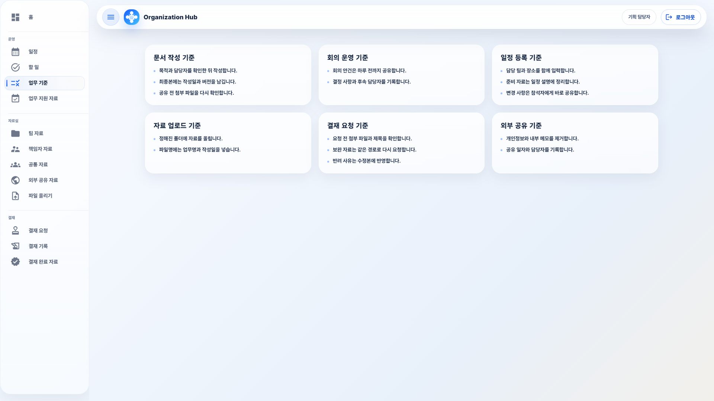

### Google 연결 설정

운영 Google 계정을 연결하고 조직에서 사용할 자료 위치, 일정, 할 일 목록을 준비합니다.  
일반 사용자는 별도로 Google에 로그인하지 않고 Organization Hub 화면에서 업무를 처리합니다.

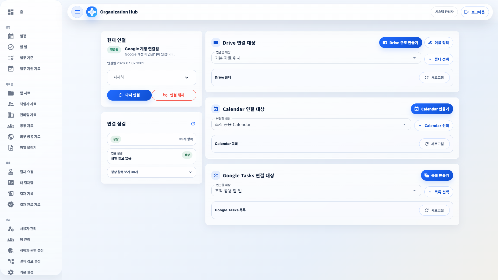

## 문서 안내

README는 제품의 방향과 사용 가치를 소개합니다.  
배포와 운영에 필요한 자세한 내용은 아래 문서에서 확인합니다.

| 문서 | 내용 |
| --- | --- |
| [문서 안내](docs/index.md) | 전체 문서 목록과 읽는 순서 |
| [배포 가이드](docs/deployment-guide.md) | 배포 준비·실행·백업·업데이트 |
| [운영 가이드](docs/operation-guide.md) | 팀·직책·권한·자료 위치·일정·할 일·결재 경로·메뉴·업무 기준 설정 |
| [권한 정책](docs/permission-policy.md) | 시스템 관리자·관리팀·팀별 직책·권한 범위·메뉴 접근 원칙 |
| [Google 연동 가이드](docs/google-integration-guide.md) | Google 계정 연결과 운영 자료 준비 |
| [보안 정책](docs/security-policy.md) | 인증·권한 확인·Google 데이터 관리 |
| [기술 개요](docs/technical-overview.md) | 제품 구조와 데이터 관리 방식 |
| [유지보수 가이드](docs/development-guide.md) | 로컬 실행·점검·변경 관리 |
